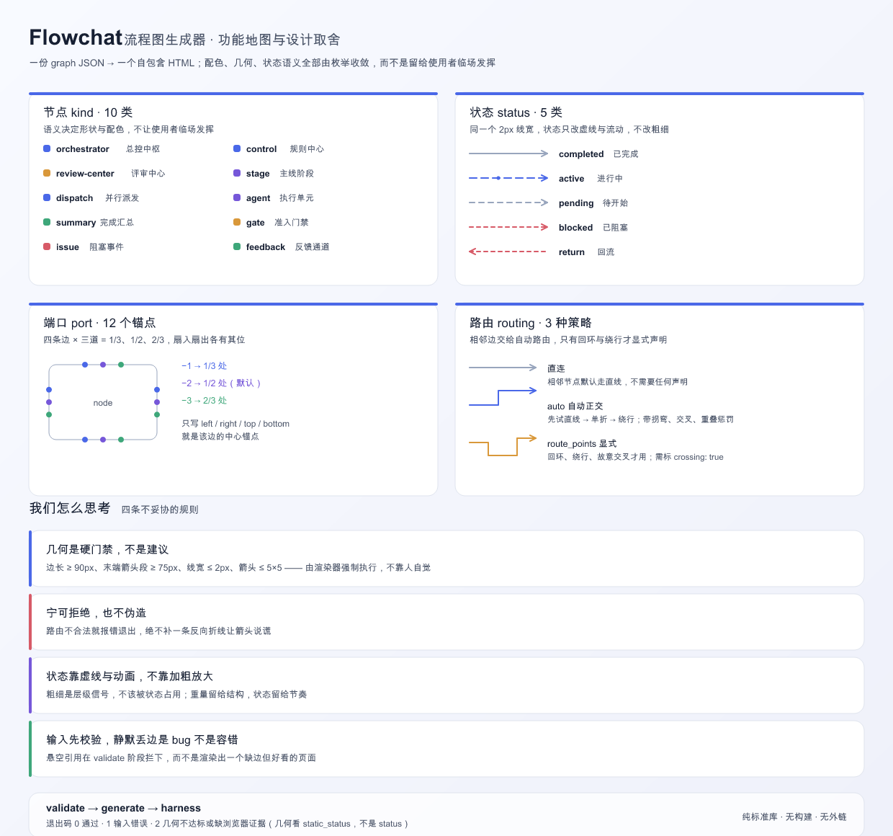

# Flowchat · 流程图生成器

**Flowchat** 是一个流程图生成器：从 graph JSON 生成**单个、自包含、双击即可打开**的流程图 HTML 页面。
无外部依赖、无 CDN、无构建步骤、纯 Python 3.10+ 标准库。

产出页面自带：流程视图 / 架构视图 / 时序视图、节点点击、阶段子流程、边状态动画、事件日志、拖拽、滚轮缩放、双指缩放钩子、自适应视图。

<p align="center">
  
  <br>
  <sub>功能地图与设计取舍（<code>tools/render_capability_map.py</code> 可重生成）</sub>
</p>

```bash
python3 scripts/generate_flowchat.py \
  --graph examples/minimal.graph.json \
  --theme examples/theme.example.json \
  --title "交付流程" \
  --output out/flowchat.html
```

打开 `out/flowchat.html` 就是结果。

## 安装

把整个目录放到你的 agent 客户端的 skills 目录下即可，**不需要任何安装命令**。

| 客户端 | 放置路径 |
| --- | --- |
| Codex | `~/.codex/skills/flowchat/` |
| Claude Code | `~/.claude/skills/flowchat/` |
| Cursor | `~/.cursor/skills/flowchat/` |
| 其他 / 手动 | 任意位置，cd 进去直接跑命令 |

推荐方式：

```bash
git clone <this-repo> ~/.codex/skills/flowchat
```

## 三条命令

```bash
# 1. 校验输入（必做：悬空引用会直接报错，不会静默漏画）
python3 scripts/validate_graph.py examples/minimal.graph.json

# 2. 生成页面
python3 scripts/generate_flowchat.py --graph examples/minimal.graph.json --output out/flowchat.html

# 3. 几何门禁（可选质量检查）
python3 harness/flowchat_local_harness.py out/flowchat.html --output out/harness-report.json
```

`--graph` 和 `--theme` 都可省略：省略 `--graph` 渲染内置的 22 节点示例图，省略 `--theme` 用内置浅色主题。

### 退出码

| 命令 | 0 | 1 | 2 |
| --- | --- | --- | --- |
| `validate_graph.py` | 通过 | 图有错误（已打印具体字段与边 id） | 文件不存在或 JSON 非法 |
| `generate_flowchat.py` | 已生成 | — | 几何不达标，未写文件（已打印是哪条边、怎么修） |
| `flowchat_local_harness.py` | 全部通过 | — | 静态失败，**或**缺少浏览器回执 |

**关于 harness 退出码 2**：它是"证据门禁"，不是"几何失败"。没有浏览器回执时 `status` 恒为 `blocked`，退出码恒为 2。判断几何是否合格请看报告里的 `static_status` 字段：

```bash
python3 -c "import json;print(json.load(open('out/harness-report.json'))['static_status'])"
```

需要完整的浏览器证据时才用 `scripts/self_check_flowchat.py`（`--browser-receipt` 是必填参数）。

## 输入格式

最小可用：

```json
{
  "nodes": [{"id": "a", "label": "开始", "x": 60, "y": 300, "width": 180, "height": 90},
            {"id": "b", "label": "结束", "x": 380, "y": 300, "width": 180, "height": 90}],
  "edges": [{"id": "e1", "source": "a", "target": "b"}]
}
```

| 层级 | 字段 |
| --- | --- |
| 节点 | `id` `label` `shape` `x` `y` `width` `height` `status` `kind` `order` |
| 边 | `id` `source` `target` `status` `kind` `route_points` `routing` `source_side` `target_side` `source_port` `target_port` `label` `label_x` `label_y` `crossing` |
| 顶层 | `viewBox` `nodes` `edges` `subflows` |

- **节点 `kind`**：`orchestrator` `control` `review-center` `stage` `dispatch` `agent` `summary` `gate` `issue` `feedback`
- **状态**：`completed` `active` `pending` `blocked` `return`。状态用虚线和动画表达，不加粗线条、不放大箭头。
- **端口**：`left-1/2/3`、`right-1/2/3`、`top-…`、`bottom-…`。扇入扇出用编号端口，边才会落在稳定且互不重叠的锚点上。
- **路由**：普通相邻边不要给 `route_points`，交给自动路由；只有回环、绕行、显式交叉才保留，并标 `crossing: true`。
- **子流程**：`subflows` 以阶段节点 id 为 key，每个含 `title` `entry` `next` `loop` `nodes` `edges`。

完整规则（端口解析、居中对齐、层级优先、几何下限）见 [SKILL.md](SKILL.md)。

## 主题

可选 JSON，覆盖 [references/theme.md](references/theme.md) 里任意令牌，未提供的用内置默认值。只覆盖令牌，不要用全局选择器改写宿主页面。

```bash
python3 scripts/generate_flowchat.py --graph my.json --theme examples/theme.example.json --output out/x.html
```

## 几何是内建保证的

渲染器自己会拒绝非法路由，而不是补一个反向折线让箭头骗人。生成结果恒定满足：

- 边长 ≥ 90 px，末端箭头段 ≥ 75 px
- 无零长 / 反向 / 斜向线段
- 端点吸附到声明的节点边；对齐端口保持直线
- 连线 ≤ 2 px，箭头 ≤ 5×5
- 文字居中且不溢出，菱形文字居中
- 不穿过中间节点

## 常见问题

**图生成了，但某条边没画出来**
先跑 `validate_graph.py`。边的 `source` / `target` 指向不存在的节点时，旧行为是静默丢弃，现在校验阶段会直接报 `ERROR: edge xxx 'target' points to 'ghost', which is not a declared node`。

**页面打开是空白**
确认是用浏览器直接打开 HTML 文件；页面不依赖任何本地服务，但 `file://` 下浏览器控制台若有扩展注入的报错属正常现象。

**能不能改生成的 HTML**
不要。改图或改主题重新生成。手工改动会在下次生成时被覆盖，也会让几何门禁失去意义。

**能嵌到别的项目里吗**
可以，但必须保留 `flowchat` 命名空间与样式隔离，不要通过全局 `.node` / `.edge` 选择器改写宿主页面。

## 目录

```
SKILL.md                        # agent 读取的行为规则（路径、契约、硬约束）
README.md
scripts/validate_graph.py       # 生成前输入校验
scripts/generate_flowchat.py    # 渲染器
scripts/self_check_flowchat.py  # 完整门禁（需浏览器回执）
harness/flowchat_local_harness.py  # 静态几何 + 交互钩子门禁
references/theme.md             # 主题令牌
examples/minimal.graph.json     # 可直接跑通的最小示例
examples/theme.example.json     # 主题覆盖示例
tools/render_capability_map.py  # 重生成 docs/capability-map.{svg,png}
docs/capability-map.png         # README 功能地图图片
```

## License

MIT — 见 [LICENSE](LICENSE)。
